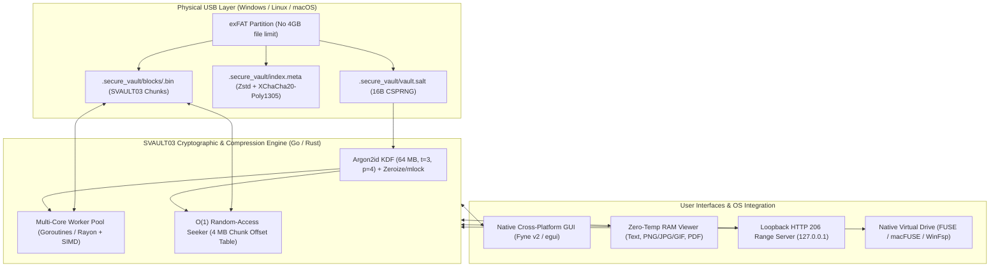

<div align="center">

# 🔐 SecureHUB (SVAULT03)

**High-Performance Cross-Platform Encrypted & Compressed USB Virtual Filesystem**  
*Dual Implementation in **Go** (Fyne) & **Rust** (egui + Rayon + SIMD + Zeroize)*

[](https://github.com/kimiko88/SecureHUB/actions/workflows/release.yml)
[](https://go.dev/)
[-DEA584?logo=rust)](https://www.rust-lang.org/)
[](#svault03-wire-format)
[](LICENSE)
[](#quick-start)

[English](#-overview) • [Italiano](#-panoramica-italiano) • [Architecture](ARCHITECTURE.md) • [Security Policy](SECURITY.md) • [Contributing](CONTRIBUTING.md)

</div>

---

## 🚀 Overview

**SecureHUB** transforms any standard USB flash drive or external SSD into a zero-trust, hardware-agnostic encrypted and compressed vault that works natively across **Windows, Linux, and macOS** without requiring kernel drivers for proprietary filesystems (such as LUKS, BitLocker, or APFS).

It combines a physical **exFAT** partition with the **SVAULT03** user-space cryptographic engine:
* **State-of-the-Art AEAD Cryptography:** Key derivation via **Argon2id** (64 MB RAM, 3 iterations, 4 lanes) paired with **XChaCha20-Poly1305** (256-bit key, 192-bit extended nonce).
* **High-Speed Zstandard Compression:** Compresses every 4 MB chunk with **Zstd** prior to encryption, achieving decompression speeds exceeding 1,000 MB/s.
* **Multi-Core Parallel Pipeline:** Saturates all CPU cores ('runtime.NumCPU()' in Go / 'rayon' work-stealing in Rust) while preserving strict sequential chunk ordering.
* **$O(1)$ Random-Access Video Streaming:** Implements 'io.ReadSeeker' / 'ReadAt' over 4 MB chunks and exposes a local loopback 'HTTP 206 Partial Content' ('Range') server. Jump to minute 90 of a 20 GB 4K movie instantaneously without extracting temporary files to disk.
* **Native Virtual Disk Mount (FUSE / WinFsp):** Mount the encrypted vault as a native OS drive ('Z:' on Windows, '/mnt/secureusb' on Linux/macOS).
* **Zero-Temp In-RAM Previewers:** Built-in text editor, image viewer ('PNG', 'JPEG', 'GIF'), and 'PDF' reader that decode streams directly in RAM.

---

## 🇮🇹 Panoramica (Italiano)

**SecureHUB** consente di formattare qualsiasi chiavetta USB in **exFAT** (per la massima compatibilità nativa con Windows, Linux e macOS) e di gestirvi all'interno un **Virtual Filesystem (VFS) cifrato e compresso** basato sul protocollo **SVAULT03**:

1. **Zero Dipendenze dal File System Ospite:** I nomi dei file e la gerarchia delle cartelle sono cifrati dentro 'index.meta'; su disco compaiono solo blocchi offuscati '<UUID>.bin'.
2. **Streaming a Blocchi da 4 MB a RAM Costante:** Importa ed esporta file di decine di gigabyte mantenendo un'impronta di memoria costante.
3. **Riproduzione Video Istantanea ($O(1)$ Seek):** Grazie alla tabella 'ChunkSizes', il lettore multimediale decifra al volo solo il singolo blocco da 4 MB corrispondente al minuto selezionato.
4. **Doppia Implementazione Interoperabile (Go & Rust):** I due motori condividono lo stesso identico formato binario su disco ('SVAULT03').

---

## 🏗️ System Architecture



---

## 🧬 SVAULT03 Wire Format

Every file stored inside '.secure_vault/blocks/<UUID>.bin' follows the **STREAM** chunked AEAD construction to prevent chunk reordering, splice attacks, and premature truncation:

```text
+--------------------+-------------------+--------------------------------------------------+
|   Magic Header     |     Stream ID     |               Sequence of Chunks                 |
|  "SVAULT03" (8 B)  |  CSPRNG (15 B)    |           Chunk 0, Chunk 1, ... Chunk N          |
+--------------------+-------------------+--------------------------------------------------+
                                         |
         +-------------------------------+-------------------------------+
         v                                                               v
+--------------------+-----------------------------------+-------------------------------+
|  CipherLen (4 B)   |     Ciphertext (Variable)         |      Poly1305 Tag (16 B)      |
|   uint32 LE        |  XChaCha20(Zstd(PlainChunk ≤4MB)) | Authenticates AAD + Ciphertext|
+--------------------+-----------------------------------+-------------------------------+
```

* **Per-Chunk 24-Byte Nonce:** `StreamID (15B) || ChunkIndex_BE64 (8B) || FinalEOF_Flag (1B: 0x00 or 0x01)`
* **Per-Chunk 17-Byte AAD:** `"SVAULT03" (8B) || ChunkIndex_BE64 (8B) || FinalEOF_Flag (1B)`

---

## ⚡ Go vs. Rust Implementation Matrix

Both engines live in this repository and are 100% binary-compatible on disk:

| Feature / Subsystem | Go Implementation (`/`) | Rust Implementation (`/secureusb-rs`) |
| :--- | :--- | :--- |
| **GUI Framework** | `Fyne v2` (OpenGL / GLFW) | `eframe / egui` (Immediate-mode native) |
| **Parallelism** | Channel-of-Channels FIFO + Goroutines | `rayon` Work-Stealing + Batch ParIter |
| **AEAD Memory Model** | Pooled `sync.Pool` 4 MB Buffers | **In-Place Zero-Copy** (`AeadInPlace`) |
| **Hardware Acceleration** | Go ASM (`x/crypto` & `klauspost/zstd`) | Explicit **AVX2 / BMI2 / NEON** (`.cargo/config.toml`) |
| **RAM Key Protection** | Scoped Heap Memory | `ZeroizeOnDrop` + OS Page Locking (`libc::mlock`) |
| **Fuzzing & Benchmarks** | `testing.F` + `testing.B` | `proptest` + `cargo-fuzz` (libFuzzer) + `Criterion` |

---

## 🛠️ Quick Start

### Option A: Build & Run the Rust Edition (Recommended for Maximum Throughput)

```bash
cd secureusb-rs

# Run GUI in optimized release mode (SIMD + Fat LTO enabled)
cargo run --release

# Run Unit, Integration, E2E, and Property-Fuzz tests
cargo test --release

# Run statistical Criterion benchmarks
cargo bench
```

### Option B: Build & Run the Go Edition

```bash
# Synchronize dependencies (requires C compiler for Fyne/CGO)
go mod tidy

# Run Unit, Integration, and E2E tests with Race Detector
go test -v -race ./internal/vault/...

# Run native Go Fuzzing
go test -fuzz=FuzzVaultRoundTripAndSeeker -fuzztime=15s ./internal/vault

# Build standalone executable
go build -ldflags="-s -w" -o secureusb .
```

---

## 🧪 Testing & Verification Suite

| Test Layer | Go Command | Rust Command | Verified Invariants |
| :--- | :--- | :--- | :--- |
| **Unit Tests** | `go test ./internal/vault -run Unit` | `cargo test --lib` | Nonce/AAD uniqueness, path normalization, key derivation |
| **Integration** | `go test ./internal/vault -run Integration` | `cargo test --test integration_e2e_fuzz` | Multi-core chunking, Poly1305 bit-flip & EOF truncation detection |
| **End-to-End (E2E)** | `go test ./internal/vault -run E2E` | `cargo test test_full_lifecycle` | Full lifecycle, cross-chunk `Seek`, `HTTP 206 Partial Content` |
| **Fuzzing** | `go test -fuzz=FuzzVaultRoundTripAndSeeker` | `cargo +nightly fuzz run fuzz_seeker` | Arbitrary payload lengths, boundary seeks, random `ReadAt` |

---

## 📄 Documentation

* [**ARCHITECTURE.md**](ARCHITECTURE.md) — Deep dive into the `SVAULT03` protocol, $O(1)$ seeker math, and concurrency pipeline.
* [**SECURITY.md**](SECURITY.md) — Threat model, cryptographic parameters, and vulnerability reporting.
* [**CONTRIBUTING.md**](CONTRIBUTING.md) — Development setup, coding standards, and pull request workflow.
* [**CHANGELOG.md**](CHANGELOG.md) — Release history and protocol evolution.

---

## 📜 License

Distributed under the **MIT License**. See [`LICENSE`](LICENSE) for full details.
