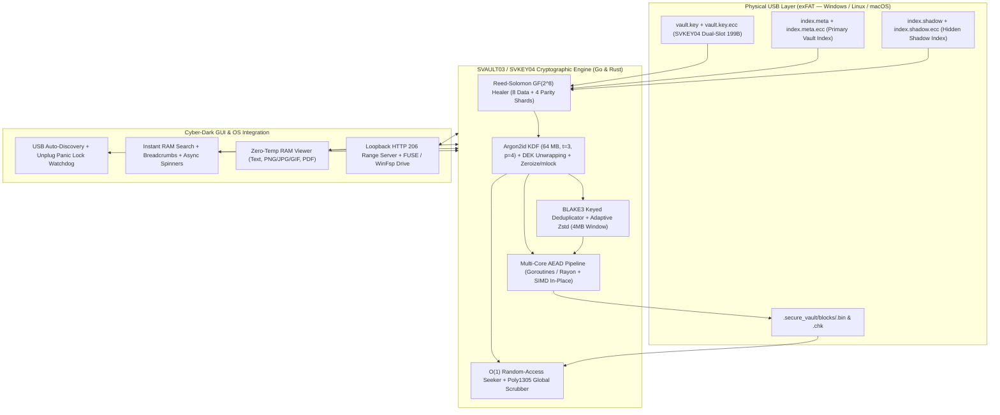

<div align="center">

# 🔐 SecureHUB (SVAULT03 / SVKEY04)

**High-Performance Cross-Platform Encrypted, Deduplicated & Self-Healing USB Virtual Filesystem**  
*Dual Implementation in **Go** (Fyne) & **Rust** (egui + Rayon + SIMD + Zeroize)*

[](https://github.com/kimiko88/SecureHUB/actions/workflows/release.yml)
[](https://go.dev/)
[-DEA584?logo=rust)](https://www.rust-lang.org/)
[](#wire-formats--cryptographic-envelopes)
[-059669)](#wire-formats--cryptographic-envelopes)
[](#wire-formats--cryptographic-envelopes)
[](LICENSE)

[English](#-overview) • [Italiano](#-panoramica-italiano) • [Architecture](ARCHITECTURE.md) • [Security & Threat Model](SECURITY.md) • [Contributing](CONTRIBUTING.md) • [Changelog](CHANGELOG.md)

</div>

---

## 🚀 Overview

**SecureHUB** turns any standard USB flash drive or external SSD into a zero-trust, self-healing, hardware-agnostic encrypted vault that runs natively across **Windows, Linux, and macOS** without requiring kernel drivers for proprietary filesystems (such as LUKS, BitLocker, or APFS).

By pairing a physical **exFAT** partition with the **SVAULT03 / SVKEY04** cryptographic engine, it delivers:

* **🕵️ Plausible Deniability (Dual-Slot Hidden Shadow Vault):** `vault.key` (`SVKEY04`, fixed 199 bytes) always contains two indistinguishable 96-byte key slots. Entering the *Primary Password* unlocks Slot 0 (`index.meta` with decoy files), while entering the *Secret Shadow Password* unlocks Slot 1 (`index.shadow`). Even when unconfigured, Slot 1 and `index.shadow` are populated with CSPRNG noise, making it mathematically impossible to prove a second vault exists.
* **🧬 Content-Addressed Deduplication (`BLAKE3` Keyed Hash):** Computes `CID = BLAKE3_Keyed(DEK, PlainChunk_4MB)` prior to compression and encryption. Identical 4 MB chunks across duplicate files or VM snapshots are stored on disk **only once** ($O(1)$ skip) and tracked via encrypted reference counts.
* **🛡️ Self-Healing Anti Bit-Rot (`Reed-Solomon GF(2^8)`):** Protects critical metadata (`index.meta`, `index.shadow`, `vault.key`) with '.ecc' sidecar files (`RSECC01`: 8 data shards + 4 Cauchy parity shards + per-shard SHA-256). Automatically repairs up to **33.3% corrupted NAND sectors** via Gaussian elimination in $\text{GF}(2^8)$ before `Poly1305` verification.
* **🔑 Instant Password Change (Key Wrapping) & Global `Poly1305` Scrubbing:** Re-wraps the 256-bit Master Data Encryption Key (**DEK**) in milliseconds without re-encrypting gigabytes of data, and verifies 100% of disk blocks across all CPU cores on demand.
* **⚡ Entropy-Adaptive `Zstd` (4 MB Window) + Multi-Core `XChaCha20-Poly1305`:** Samples Shannon entropy on the first 16 KB of each chunk to dynamically switch between high compression (Level 6 with 4 MB LZ77 window) and fast bypass (Level 1) for already-compressed media.
* **🎬 $O(1)$ Random-Access Video Streaming & Zero-Temp RAM Viewers:** Built-in text editor, image viewer (`PNG/JPEG/GIF`), `PDF` reader in RAM, loopback `HTTP 206 Partial Content` (`Range`) streaming server, and native **FUSE / macFUSE / WinFsp** virtual drive mounting.
* **🔌 Automatic USB Hot-Plug Detection & Emergency Panic Lock:** Automatically detects inserted USB drives, highlights active vaults, supports **Drag & Drop** of files/folders (automatically filtering OS junk like '.DS_Store' and 'Thumbs.db'), and **immediately zeroes the DEK in RAM** if the USB drive is physically unplugged.

---

## 🇮🇹 Panoramica (Italiano)

**SecureHUB** permette di formattare qualsiasi chiavetta USB in **exFAT** e di gestirvi all'interno un **Virtual Filesystem (VFS) cifrato, deduplicato e auto-riparante** compatibile nativamente con **Windows, Linux e macOS**:

1. **Plausible Deniability (Doppio Vault Nascosto):** Inserendo la *Password Primaria* si apre `index.meta`; inserendo la *Password Segreta* si apre il volume fantasma `index.shadow`.
2. **Deduplicazione Content-Addressed (`BLAKE3`):** I blocchi da 4 MB identici vengono individuati tramite `BLAKE3_Keyed(DEK, chunk)` e salvati sulla chiavetta una sola volta.
3. **Auto-Riparazione Bit-Rot (`Reed-Solomon GF(2^8)`):** I file '.ecc' riparano automaticamente in RAM e su disco fino a 4 shard corrotti su 12 prima della verifica crittografica `Poly1305`.
4. **Rilevamento Automatico USB, Panic Lock e Drag & Drop:** Individua in automatico le chiavette inserite, blocca il Vault azzerando la RAM se la chiavetta viene estratta fisicamente e filtra automaticamente i file spazzatura ('.DS_Store', 'Thumbs.db', 'desktop.ini', '*.tmp') durante l'importazione di file e cartelle.

---

## 🏗️ System Architecture



---

## 🧬 Wire Formats & Cryptographic Envelopes

### 1. `SVKEY04` Dual-Slot Key Envelope (`vault.key` — 199 Bytes)
Provides **Instant Key-Wrapped Password Changes** and **Plausible Deniability**:

```text
+-------------------+------------------------------------+------------------------------------+
|   Magic Header    |        Slot 0 (Primary Vault)      |   Slot 1 (Shadow Vault / CSPRNG)   |
|  "SVKEY04" (7 B)  |  Salt(16B)+Nonce(24B)+DEK_Tag(48B) |  Salt(16B)+Nonce(24B)+DEK_Tag(48B) |
|                   |           + RandomPad(8B) = 96 B   |           + RandomPad(8B) = 96 B   |
+-------------------+------------------------------------+------------------------------------+
```

### 2. `RSECC01` Reed-Solomon Sidecar (`*.ecc`)
Protects against NAND flash bit-rot using a systematic $12 \times 8$ Cauchy matrix over $\text{GF}(2^8)$:

```text
+-------------------+------------------+------------------+--------------------+------------------------+
|   Magic Header    |   OriginalSize   |    ShardSize     |  12 Shard Hashes   |   4 Parity Shards      |
| "RSECC01\0" (8 B) |    uint64 LE     |    uint32 LE     | 12 * SHA256 (384B) | 4 * ShardSize (GF(256))|
+-------------------+------------------+------------------+--------------------+------------------------+
```

### 3. `SVAULT03` Stream Blocks (`<UUID>.bin`) & Deduplicated Chunks (`<CID>.chk`)
* **Stream Blobs (`.bin`):** '[Magic "SVAULT03" (8B)] + [StreamID (15B)] + Chunk_0 + ... + Chunk_N', where each 4 MB chunk binds `ChunkIndex_BE64` and `FinalEOF_Byte` into both the 24-byte `XChaCha20` Nonce and 17-byte `Poly1305` AAD.
* **Deduplicated Chunks (`.chk`):** Addressed by `CID = Hex(BLAKE3_Keyed(DEK, PlainChunk))` with packet layout '[Nonce (24B)] + [XChaCha20-Poly1305(Zstd(PlainChunk), AAD = BLAKE3_Raw32B)]'.

---

## ⚡ Go vs. Rust Implementation Matrix

Both engines live side-by-side in this repository and are 100% binary-compatible on disk:

| Subsystem | Go Edition (`/`) | Rust Edition (`/secureusb-rs`) |
| :--- | :--- | :--- |
| **GUI Framework & Theme** | `Fyne v2` (`SecureCyberTheme` Dark Slate/Emerald) | `eframe / egui` (Cyber-Dark + Async `mpsc` Spinners) |
| **Multi-Core Pipeline** | Channel-of-Channels FIFO + Goroutines | `rayon` Work-Stealing + **In-Place AEAD** (`AeadInPlace`) |
| **SIMD Acceleration** | Go ASM (`x/crypto` & `klauspost/zstd`) | Explicit **AVX2 / BMI2 / NEON** (`.cargo/config.toml`) |
| **RAM Key Hygiene** | Explicit DEK/KEK Zeroing + Unplug Watchdog | `ZeroizeOnDrop` + `libc::mlock` + Unplug Watchdog |
| **BLAKE3 Deduplication** | Zero-Dependency Native RFC `BLAKE3` Keyed Engine | `blake3` Crate with SIMD Assembly |
| **Reed-Solomon $\text{GF}(2^8)$** | Native Cauchy Matrix + Gauss-Jordan Inverter | Native Cauchy Matrix + `sha2` Shard Verification |

---

## 🛠️ Quick Start

### 1. Build & Run the Rust Edition
```bash
cd secureusb-rs

# Run GUI in optimized release mode (SIMD + Fat LTO enabled)
cargo run --release

# Run all Unit, Integration, E2E, Proptest, and v0.4.0 Architectural Tests
cargo test --release
```

### 2. Build & Run the Go Edition
```bash
# Synchronize dependencies
go mod tidy

# Run all Unit, Integration, E2E, and v0.4.0 Architectural Tests (Shadow, Dedup, ECC)
go test -v -race ./internal/vault/...

# Build standalone executable
go build -ldflags="-s -w" -o secureusb .
```

---

## 🧪 Testing & Verification Suite

| Test Suite | Go Command | Rust Command | Verified Capabilities |
| :--- | :--- | :--- | :--- |
| **v0.4.0 Architecture** | `go test -v -run TestV4 ./internal/vault` | `cargo test --test v4_features_test` | Dual-Vault Plausible Deniability, `BLAKE3` Dedup, `Reed-Solomon` Bit-Rot Healing |
| **Integration & Folders** | `go test -v -run Integration ./internal/vault` | `cargo test --test integration_e2e_fuzz` | Multi-core chunking, recursive `ImportDir/ExportDir`, OS junk filter |
| **End-to-End (E2E)** | `go test -v -run E2E ./internal/vault` | `cargo test test_full_lifecycle` | Full lifecycle, $O(1)$ cross-chunk `Seek`, `HTTP 206 Range` streaming |
| **Fuzzing & Benchmarks** | `go test -fuzz=FuzzVaultRoundTripAndSeeker` | `cargo bench` | Mutation fuzzing on arbitrary offsets & throughput in MB/s |

---

## 📄 Documentation

* [**ARCHITECTURE.md**](ARCHITECTURE.md) — Mathematical & engineering specification of `SVAULT03`, `SVKEY04`, `BLAKE3` dedup, and `Reed-Solomon GF(2^8)`.
* [**SECURITY.md**](SECURITY.md) — Threat model, Plausible Deniability guarantees, and vulnerability disclosure policy.
* [**CONTRIBUTING.md**](CONTRIBUTING.md) — Developer workflow and cross-language compatibility rules.
* [**CHANGELOG.md**](CHANGELOG.md) — Complete version history up to `v0.4.0`.

---

## 📜 License

Distributed under the **MIT License**. See [`LICENSE`](LICENSE) for full details.
